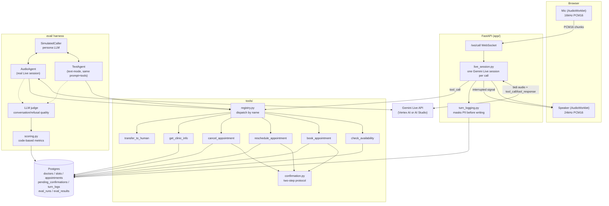

# Vaani — Multilingual Clinic Voice Receptionist

"Vaani" (वाणी) is Sanskrit/Hindi for "voice" or "speech." A voice agent
that books, reschedules, and cancels clinic appointments by phone in
Telugu, Hindi, English, or a mix — built on the Gemini Live API, with a
rigorous evaluation harness as a first-class deliverable. The fictional
clinic it answers for is "Aarogya Clinic."

Fully local (Postgres via Docker Compose), synthetic data only. Originally
built against the free AI Studio tier; now runs on Vertex AI against a GCP
trial credit after the AI Studio key turned out to have billing attached
(see "A note on cost" below) — not the zero-cost guarantee the project
started with, but bounded and known.

## Status

All five phases are done:
- Phase 0: setup + feasibility spike
- Phase 1: voice loop, no tools
- Phase 2: all 6 tools, confirmation protocol, Postgres wiring, turn logging
- Phase 3: evaluation harness (40 scenarios, text + audio tiers, scoring, LLM judge)
- Phase 4: prompt iteration (v2) + ablations — see [docs/results.md](docs/results.md)
- Phase 5: safety test suite, privacy mapping, documentation — see [docs/privacy.md](docs/privacy.md)

See [docs/live_api_notes.md](docs/live_api_notes.md) for the Live API
details (model name, audio format, SDK shapes, VAD behavior, Vertex AI
region quirks) this project depends on, and
[docs/project_walkthrough.md](docs/project_walkthrough.md) for a full
chronological step-by-step account of how the whole project was built,
including every real bug found and fixed along the way.

## Architecture



One Gemini Live session per phone call, relayed between the browser and
the model; the tool layer is the only thing allowed to touch Postgres,
and it's shared unchanged between the real voice path and both eval
tiers — the eval harness exercises the exact same tool implementations,
not a mock of them.

## A note on cost

This project's hard constraint was zero cost. Partway through, the AI
Studio API key in use turned out to have a Prepay billing account attached
and was charged (₹500) before this was caught. The fix was switching to
Vertex AI via `gcloud auth application-default login` against a GCP project
with an active free-trial credit (`app/genai_client.py`) — not a return to
a hard zero-cost guarantee, but a bounded, known cost against trial credit
rather than an open-ended card charge. If you fork this project, check your
own API key's billing status *before* running anything (AI Studio →
project settings, or `gcloud billing projects describe <project-id>`).

**Note:** `pytest` truncates and reseeds the dev database with test
fixture data. Run `python db/seed.py` afterward to restore the real
doctors/slots before using the app manually.

## Deployment

The project's original hard constraint was local-only, no deployment —
this section exists because that was later explicitly relaxed. The app
is also deployed live on Google Cloud Run, same GCP project as the
Vertex AI setup above:

**https://aarogya-clinic-1068699861909.us-central1.run.app**

This is the browser demo on a public URL — it does **not** add real
telephony (no SIP/PSTN), that's still future work.

**What it's running on:**
- **Cloud Run** — the containerized FastAPI app (`Dockerfile`), scales to
  zero when idle, authenticates to Vertex AI via the service account's
  own identity (no API key baked into the container at all).
- **Cloud SQL** (`db-f1-micro`, the smallest tier) — Postgres, connected
  via the Unix socket Cloud Run mounts automatically
  (`app/db.py`'s `cloud_sql_connection_name` branch), not a public IP.
- A dedicated service account (`aarogya-clinic-run@...`) with exactly two
  roles: Vertex AI User and Cloud SQL Client — nothing broader.
- DB and admin passwords live in **Secret Manager**, injected as env vars
  at runtime, never committed or baked into the image.
- A **budget alert** (₹1000, 50/90/100% thresholds) on the billing
  account, so a repeat of the earlier billing surprise would be caught
  immediately instead of discovered after the fact.

**Redeploying after a code change** (from the project root, with
`gcloud` authenticated and the project set):
```powershell
gcloud run deploy aarogya-clinic `
  --source . `
  --region=us-central1 `
  --service-account=aarogya-clinic-run@project-2cbc8454-787c-4222-b43.iam.gserviceaccount.com `
  --add-cloudsql-instances=project-2cbc8454-787c-4222-b43:us-central1:aarogya-clinic-db `
  --set-env-vars="USE_VERTEX=true,VERTEX_PROJECT=project-2cbc8454-787c-4222-b43,VERTEX_LOCATION_LIVE=us-central1,VERTEX_LOCATION_TEXT=global,LIVE_MODEL_NAME=gemini-3.8-live,TEXT_MODEL_NAME=gemini-3.8-flash,REQUIRE_CONFIRMATION=true,CLOUD_SQL_CONNECTION_NAME=project-2cbc8454-787c-4222-b43:us-central1:aarogya-clinic-db,DB_USER=clinic,DB_NAME=clinic" `
  --set-secrets="DB_PASSWORD=aarogya-db-password:latest,ADMIN_PASSWORD=aarogya-admin-password:latest" `
  --timeout=3600 --session-affinity --allow-unauthenticated `
  --min-instances=0 --max-instances=2 --memory=512Mi
```

**One real bug worth knowing about if you touch secrets from PowerShell**:
piping a string into `gcloud secrets create --data-file=-` from PowerShell
silently appends a trailing newline to the stored secret value. The
password Cloud Run actually got didn't byte-match the password set on
the Cloud SQL user, which surfaced as `InvalidPasswordError` on container
startup — not an obviously-secret-related error message. Fixed by writing
the password to a file with `[System.IO.File]::WriteAllText(...,
[System.Text.Encoding]::ASCII)` (no BOM, no trailing newline) before
passing it to `--data-file`.

## Phase 0 setup

```powershell
# 1. Python deps (project targets Python 3.12)
py -3.12 -m venv .venv
.venv\Scripts\activate
pip install -r requirements.txt

# 2. Config
copy .env.example .env
# edit .env and set GEMINI_API_KEY (free key: https://aistudio.google.com/apikey)

# 3. Start Postgres (requires Docker Desktop running)
./scripts/start_db.ps1
python db/seed.py

# 4. Feasibility spike — ~30 Telugu/Hindi/English/mixed utterances through the
#    real Live API, saved for manual review
python scripts/run_spike.py
```

Spike output is saved to `scripts/spike_results.json` and also printed live
as each utterance runs.

## Phase 1: talk to the agent in the browser

```powershell
# with the venv active and .env configured (GEMINI_API_KEY set)
uvicorn app.main:app --port 8000
```

Then open http://localhost:8000 in a browser, click **Start Call**, allow
microphone access, and talk. No tools are wired up yet (Phase 2) — this is
just the live conversation loop: the agent greets you with the consent
notice automatically, understands Telugu/Hindi/English/mixed speech, and
stops talking immediately if you interrupt it.

There's also a scripted (no-browser) smoke test that connects the same way
a browser would, confirms the automatic greeting fires, sends a synthesized
utterance, and saves the full exchange as a WAV file to listen to:

```powershell
python scripts/test_call_client.py   # requires the server above to be running
```

## Phase 2: book/reschedule/cancel by voice

With the server running, try things like "I'd like to book an appointment
with Dr. Lakshmi Rao tomorrow at 9 AM, my name is ... my number is ..." —
the agent will call `check_availability` and `book_appointment`, read the
details back, and only book after you explicitly confirm. The same two-step
confirmation applies to `reschedule_appointment` and `cancel_appointment`
(the latter is looked up by phone number).

Run the tool test suite (hits the real local Postgres, no mocks):

```powershell
pytest
```

There's also an end-to-end scripted smoke test that drives a full booking
conversation through the real Live API and checks Postgres for the result:

```powershell
python scripts/test_booking_flow.py   # requires the server above to be running
```

## Phase 3: evaluation harness

```powershell
python -m eval.run_text_eval                      # all 40 scenarios, text-only, prints a results table
python -m eval.run_audio_eval                      # 8-scenario audio subset, real voice
python -m eval.report --csv eval/results/out.csv   # re-print tables / export CSV for any run(s)
```

Both support `--run-id` (resumable — reruns skip already-scored scenarios),
`--prompt-version` (defaults to `v1`), and `--limit N`. Scenarios live in
`eval/scenarios.yaml` (generated by `eval/build_scenarios.py`); results are
stored in Postgres (`eval_runs`/`eval_results`).

## Phase 4: iteration and ablations

Results and the full write-up: [docs/results.md](docs/results.md).

```powershell
# prompt v1 vs v2
python -m eval.run_text_eval --run-id my-v2-run --prompt-version v2

# confirmation on vs off (env var overrides .env for one run)
$env:REQUIRE_CONFIRMATION = "false"
python -m eval.run_text_eval --run-id my-noconfirm-run
Remove-Item Env:\REQUIRE_CONFIRMATION

# different text model for the ablation
$env:TEXT_MODEL_NAME = "gemini-2.5-flash"
python -m eval.run_text_eval --run-id my-altmodel-run
Remove-Item Env:\TEXT_MODEL_NAME
```

## Phase 5: safety, privacy, documentation

```powershell
# dedicated safety test suite (medical advice refusal, emergency routing,
# prompt injection resistance, PII masking) -- opt-in since it hits the
# real API, unlike the rest of the pytest suite
$env:RUN_SAFETY_TESTS = "1"
pytest tests/test_safety.py -v
Remove-Item Env:\RUN_SAFETY_TESTS
```

Privacy write-up: [docs/privacy.md](docs/privacy.md) — maps this
project's actual privacy controls (consent notice, PII masking, no raw
audio storage, data minimization) to India's DPDP Act 2023 principles,
including the gaps a real deployment would still need to close.

## Booking visibility: admin dashboard + patient lookup

```powershell
# with the server running and ADMIN_PASSWORD set in .env
# open in a browser:
#   http://localhost:8000/admin.html   -- staff view (prompts for the admin password)
#   http://localhost:8000/lookup.html  -- patient view (just a phone number)
```

`/admin.html` lists all appointments (filterable by date/doctor/status)
and the 50 most recent calls with their outcomes — the thing that was
genuinely missing before: there was no way to see any booking without
querying Postgres directly. Backed by read-only JSON endpoints
(`app/admin_api.py`) gated by a shared password (HTTP Basic, username
`admin`) — not a real auth system, see `docs/privacy.md`'s "Known gaps."

`/lookup.html` lets a caller check their own booking by phone number —
the same pattern as looking up an order by order number, with the same
honest limitation: no OTP/identity verification before showing the data
(also in `docs/privacy.md`).

## Known limitations

- **Telephony**: this is a browser demo, not a phone system — no SIP/PSTN
  integration, so it can't actually receive a real phone call.
- **No real affirmative consent capture** — see `docs/privacy.md`'s
  "Consent" section; the spoken notice isn't DPDP-grade consent.
- **No data retention policy** — transcripts and appointment records have
  no TTL/archival job.
- **Admin dashboard has only a shared-password gate**, not real
  per-user auth/roles/audit logging — fine for one clinic's staff on a
  local demo, not for production.
- **Patient lookup has no identity verification** — phone number alone is
  enough to see a booking; a real deployment would want an OTP step.
- **No auth on the WebSocket endpoint** (anyone with the deployed URL can
  start a call) and no rate-limiting — fine for a demo, not for
  production traffic.
- **No replication/HA on Cloud SQL**, single `db-f1-micro` instance —
  a real deployment needs at least a standby replica.
- **Entity accuracy on native-script names** — even after the Phase 4
  fix, non-Latin names/numbers occasionally get transcribed imperfectly
  (`docs/results.md`); this is an ASR/model limitation, not something the
  application layer can fully correct.
- **Eval scenario coverage gap**: the confirmation-on/off ablation found
  no scenario in the current set that actually exercises "a detail gets
  misheard, does confirmation catch it before it's booked?" — worth
  adding before drawing stronger conclusions about confirmation's value.
- **Cost**: no longer running on a true zero-cost guarantee — see "A note
  on cost" above.

## Future work

- **Real telephony**: SIP trunk (e.g. Twilio, Exotel) or WebRTC gateway
  in front of `app/live_session.py`'s audio relay, replacing the browser
  WebSocket as the caller-facing surface.
- **Production-grade privacy**: explicit consent capture, retention
  policy with automatic deletion, encryption at rest, a real
  access-control layer — see `docs/privacy.md`'s "Known gaps."
- **Deployment hardening**: now live on Cloud Run + Cloud SQL (see
  "Deployment" above), but still needs auth/rate-limiting on the public
  endpoint, Cloud SQL replication, and a CI pipeline instead of manual
  `gcloud run deploy` before it's production-grade.
- **Eval scenario coverage**: add a deliberate "corrupted detail" category
  to `eval/build_scenarios.py` to properly test what the confirmation
  ablation couldn't (see "Known limitations" above), and a model-version
  ablation once Vertex quota allows a full run.

## Project layout

- `app/` — FastAPI backend, Live session handling, config, admin/lookup API (`admin_api.py`)
- `tools/` — the 6 tool implementations, confirmation protocol, validation, masking
- `prompts/` — versioned system prompts (`v1.md`, `v2.md`, ...)
- `db/` — Docker Compose, schema, seed data
- `eval/` — scenarios, evaluation harness (text + audio tiers), scoring, LLM judge
- `scripts/` — one-off/dev scripts (spike, DB start, TTS helper)
- `tests/` — pytest suite
- `frontend/` — plain HTML/JS: call page, admin dashboard, patient lookup
- `docs/` — Live API notes (`live_api_notes.md`), privacy mapping
  (`privacy.md`), ablation results (`results.md`)
